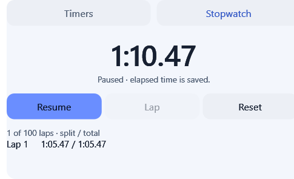

# Crest


[](https://github.com/tanmay-tiwari-20/Crest/actions/workflows/ci.yml)
[](LICENSE)

Crest is a native Windows 11 utility that opens a small island at the top-center of your desktop. A fresh hover reveals music, productivity tools, system controls, shortcuts, and a file shelf. It stays hidden while an application is active by default; an optional setting lets you open it over other apps.

**Crest 0.3.0 is a prerelease candidate.** It adds optional weather, local calendars and meeting links, managed downloads, read-only local AI, notification previews, accessory battery reads, and Phone Link access. Configure sources in **Settings → Integrations**. The [implementation and compatibility map](docs/PRD_COMPLETION.md) records supported operations and remaining physical acceptance.

## Download and install

The [0.3.0 release](https://github.com/tanmay-tiwari-20/Crest/releases/tag/v0.3.0) is being prepared as a prerelease; its page and assets become publicly downloadable when published. Open **Assets** and choose one of the following 0.3.0 packages when available:

| Package | Use it when | Installation |
|---|---|---|
| `Crest-Setup-0.3.0-x64.exe` | You want Start-menu entries and normal Windows uninstall support. | Run the installer for your Windows user account. A desktop shortcut is optional. |
| `Crest-Portable-0.3.0-x64.zip` | You want to run Crest from an extracted folder. | Extract the ZIP, keep every file together, and run `Crest.exe`. |

Both packages target **Windows 11 x64** and include the .NET runtime. You do not need an SDK, a separate runtime installation, administrator access, or a Crest account. The source-code archives on a GitHub release are for building the application; download an application package to run it.

The installer is currently unsigned. Startup with Windows is off by default and can be enabled in Settings. Portable use still stores preferences in your Windows user profile.

Compare downloaded assets with `SHA256SUMS.txt` from the same release. The previously published [0.2.1 release](https://github.com/tanmay-tiwari-20/Crest/releases/tag/v0.2.1) remains available and predates the optional integrations described here. Upgrade steps and package checks are in the [user guide](docs/USER_GUIDE.md#install).

## First use

Crest starts quietly in the system tray. Open **Crest Settings** from Start, double-click the tray icon, or right-click it and choose **Settings**.

1. Close Settings, press **Win+D**, and minimize or close any remaining visible apps on the selected display.
2. Move the pointer away from the top edge.
3. Enter the top-center edge and pause briefly. The default trigger is 240 × 3 device-independent pixels, with a 120 ms hover delay.
4. Click the chevron to expand the focus, music, and battery cards. Use the icon dock below them to open a detail panel.

A stationary pointer does not reveal Crest after Win+D, unlock, resume, or tray Resume. Move away and enter the trigger again. In desktop-only mode, opening an app dismisses Crest. Media and timer activity never reveal it automatically.

The default **strict desktop mode** requires the actual wallpaper desktop to be foreground and ordinary visible apps on the selected display to be minimized. File Explorer, Start, Search, Task View, and foreground apps on another monitor also suppress Crest. The optional desktop-active mode allows visible app windows when the actual desktop is foreground.

To open Crest while using another app, enable **Settings → Behavior → Allow Crest over other apps**. Then enter the top-center trigger on your selected display, or use **Ctrl+Alt+Space** if you also enable the accessibility reveal shortcut. This option is off by default. Settings, tray Pause, lock, suspend, and secure desktop still suppress Crest.

## Features

| Feature | Included behavior |
|---|---|
| Music | Windows media-session metadata and artwork, supported playback and seek controls, and a preferred-player selector when several sessions are available. |
| System controls (F08/F11/F12) | Connected audio-output selection with verified switching or Windows sound settings fallback; volume/mute, Windows battery warnings, supported brightness, real CPU/memory/network activity, and Wi-Fi/Bluetooth status/settings links. |
| Clock | Local date and time in the detail footer, using Windows formatting preferences. |
| Productivity (F09) | Eight independent named timers, stopwatch with 100 saved laps, work/break focus sessions, and 32 local reminders with 5/15-minute snooze and dismissal. State survives restarts; completed focus phases wait for you to continue. |
| Clipboard history (F10) | Off by default. Explicit opt-in captures new text copies locally; search, copy, pin, pause/resume, remove, clear, and 1–30-day retention. |
| Capture references (F13) | Launch the Windows screenshot tool and retain up to 12 recent image references that you explicitly select. |
| Workspaces (F14) | Save up to 20 presets of up to 20 app, file, folder, and HTTP/HTTPS website targets, then launch a group together. |
| Launch shortcuts | Explicit app, file, folder, HTTP/HTTPS website, and Windows shortcut entries. The side rail shows the first two; the detail panel shows the full list. |
| File shelf (F16) | Up to 20 references, with open, drag-out, pinning across restarts, removal, and missing-source recovery by locating a replacement or opening the nearest existing folder. Original files are not copied, moved, or deleted by Crest. |
| Personalization (F17/F18) | System/light/dark/Ocean/Forest/Rose themes, size presets, module ordering, configurable surface gestures, separate appearance/trigger preferences per display, motion, startup, optional access over other apps, and keyboard reveal. |
| Weather (F20) | Chosen-city Open-Meteo weather, current temperature/conditions/wind, last refresh, bounded cache, stale/offline states, clear and disconnect. |
| Calendar and meetings (F21/F23) | Read-only local `.ics` calendar with common recurrence, up to 200 upcoming events over 90 days, hidden event details by default, and validated Teams/Zoom/Google Meet join links. |
| Downloads (F24) | Explicit Crest-managed HTTP(S) transfers to new filenames, progress, two concurrent transfers, cancel/retry, and partial-file cleanup. Other apps' downloads are not monitored. |
| Read-only AI (F25) | Bounded typed conversation with an existing local Ollama service and selected installed model; cancel, clear, and disconnect. No model is bundled and suggestions are not executed. |
| Windows integrations (F19/F22/F26) | Permission-gated notification previews, standard BLE accessory battery reads, and capability-checked handoff to Microsoft Phone Link. Availability depends on package identity, Windows permissions, and device support. |
| Tray controls | Settings, Timers/focus/reminders, Pause / Resume, and Quit, with local due notices and a single-instance application. |

The [user guide](docs/USER_GUIDE.md) explains each module, keyboard access, upgrades, and removal.

Optional sources are **off by default**. Enabling the first source adds **Optional integrations** to the dock; Modules can hide that entry independently. Notification permission is requested from Settings. Calendar meeting actions open provider join pages; call mute and hang-up controls are unavailable. Phone pairing and phone actions remain in Phone Link.

The compact island respects enabled modules. Its status, accessible name, and action follow the displayed battery warning, timer, focus session, due reminder, or music session. Due reminder and completed focus actions open their relevant controls. The tray's **Timers, focus and reminders** opens **Settings → Activities**; live due events can notify through the Windows tray without revealing the island. Settings keeps keyboard focus and tab order when switching pages.

Timer-completion sound is off by default. Enable **Settings → Modules → Play a sound for timer completion** to hear Crest's original bundled **3.54-second chime**, including while the island is hidden. **Test timer sound** previews the chime regardless of that preference and leaves it unchanged. Completion never opens the island automatically.




These are static WPF renders using isolated test data, rather than native desktop captures.

## Privacy and local data

Crest has no analytics or required account. Optional notification access requires Windows permission; weather and downloads contact their selected servers only after opt-in and explicit configuration. AI sends only typed conversation to your chosen local Ollama service. Preferences, shortcuts, workspaces, activities, pinned shelf paths, selected capture paths, and explicitly enabled clipboard history live in `%LOCALAPPDATA%\Crest`. Unpinned shelf references clear when Crest quits. Website targets open through Windows when you select them.

Text capture is **off by default**. Enable it in **Settings → Privacy** to collect new clipboard changes while Crest runs. History is limited to 100 entries, 8,192 characters per entry, and 120,000 stored characters. Unpinned entries expire after the configured retention period; pinned text remains until removed or cleared. Pause keeps existing history and retention active. Clear removes pins too; disabling capture clears retained text. Enabling or resuming capture does not import the existing clipboard contents.

Retained clipboard text is protected with Windows DPAPI for the current user. Enabled legacy plaintext history migrates automatically. Oversized entries are shortened and labeled. If protection fails, Crest reports the problem and avoids leaving plaintext history on disk. Calendar previews, notification previews, download history, and AI conversation stay in memory; weather retains one bounded forecast cache. Each optional source offers clear or disconnect controls.

**Settings → About → Reset Crest data** asks before clearing Crest's data and disabling startup. Your original files are untouched. Installed uninstall offers a choice to retain or delete local settings.

## Compatibility and release status

The candidate targets Windows 11 x64. ARM64 and Windows 10 packages are not available. Media actions depend on the player exposing a compatible Windows session; brightness and battery details depend on hardware support and the values Windows supplies.

Current 0.3.0 verification passes **139 domain outcomes and 147 WPF/UI outcomes**. **Eleven native clipboard-writing outcomes were explicitly omitted** and are not counted as passed. Static renders and fixture checks establish their stated logic; physical Windows capabilities, clean-account installation, accessibility/display operation, and performance remain separate acceptance. See the [test report](docs/TEST_REPORT.md), [verification record](docs/prd-completion-verification.json), and [acceptance runbook](docs/P1_ACCEPTANCE_RUNBOOK.md).

Earlier 0.2.1 owner approval, desktop/shelf, installation, sound, and resource observations remain historical for their recorded binaries. They do not qualify this changed release. Cold startup, frame delivery, hidden resource use, and battery impact must be measured on the exact candidate.

Audio switching probes Windows PolicyConfig at runtime and reads back the selected default; this undocumented interface may be unavailable on a Windows build, so **Windows sound settings** is always offered. System statistics stop when hidden or when Controls is disabled.

Windows notification access can require package identity and capabilities absent from ordinary installer/portable packages. An optional MSIX packaging path declares notification access, but installable output needs a suitable signing certificate and separate package acceptance. Crest reports denied or unsupported access. BLE battery values require a connected paired accessory exposing the standard service. Weather uses the public Open-Meteo service; Ollama and its model must already be installed separately.

## Troubleshooting

**Crest does not appear:** Check the tray icon and Pause state, close Settings, show the desktop, and enter the trigger afresh. Verify the display selected in Behavior. A visible helper window can block strict mode even when the desktop looks empty. In a confirmed case, closing a WhatsApp WebView window restored hover. Close or minimize the relevant app normally and try again.

**Music is empty or controls are disabled:** Start playback in a player that exposes a Windows media session. Crest only enables actions that the player reports as supported.

**Brightness or battery information is unavailable:** These controls use Windows capabilities. An unsupported external display or a missing OS estimate is shown as unavailable.

See the [full troubleshooting guide](docs/USER_GUIDE.md#troubleshooting). Report reproducible problems through [GitHub Issues](https://github.com/tanmay-tiwari-20/Crest/issues), including your Windows version, display/scaling setup, app version, and steps to reproduce.

## Build from source

Maintainers need Windows, Git, and **.NET SDK 10.0.404**, pinned by [global.json](global.json). End users only need a release package.

```powershell
git clone https://github.com/tanmay-tiwari-20/Crest.git
cd Crest
powershell -NoProfile -ExecutionPolicy Bypass -File scripts/release.ps1 -Tag v0.3.0
```

The release script restores locked dependencies, builds, runs outcome tests, publishes a self-contained x64 app, and uses the verified Inno Setup compiler to create an installer and portable ZIP. It uses `.tools/dotnet` when available, otherwise the pinned system SDK. Upload-ready files and checksums go under `artifacts/release/`. Use `scripts/build.ps1` for a build without packaging.

For candidate preparation when the original clipboard cannot be safely backed up, `-SkipNativeClipboardVerification` explicitly omits the 11 native clipboard-writing outcomes while running the remaining suite. The omission is recorded in verification and does not satisfy full P1 qualification. Read the [release instructions](docs/RELEASING.md) before tagging or uploading assets.

For a development run, quit any other Crest instance first:

```powershell
dotnet run --project src/Crest/Crest.csproj -- --settings
```

Crest uses C#/.NET 10, WPF, Windows media APIs, Core Audio, and WMI. Read the [build instructions](docs/BUILD.md) for packaging details. Contributions should describe the user-visible change and include relevant validation; changes to reveal or suppression behavior must preserve the default desktop eligibility rules and the explicit access-mode setting.

## Documentation

- [User guide](docs/USER_GUIDE.md)
- [PRD analysis and implementation scope](docs/PRD_ANALYSIS.md)
- [0.3.0 integrations and compatibility](docs/PRD_COMPLETION.md)
- [Reference design observations](docs/REFERENCE_DESIGN.md)
- [Compatibility and test report](docs/TEST_REPORT.md)
- [P0/P1 native acceptance runbook](docs/P1_ACCEPTANCE_RUNBOOK.md)
- [Release notes](docs/RELEASE_NOTES.md)
- [Build and packaging instructions](docs/BUILD.md)
- [Release publishing steps](docs/RELEASING.md)
- [Changelog](CHANGELOG.md)
- [Contributing](CONTRIBUTING.md)
- [Security reporting](SECURITY.md)

## License

Original project code, documentation, icon, current focus artwork, and synthesized timer chime use the [MIT license](LICENSE). Dependencies retain their own licenses; see [third-party notices](THIRD_PARTY_NOTICES.md). Editable character artwork is in `assets/focus-orb.svg`; the earlier reference crop was replaced for public distribution.
