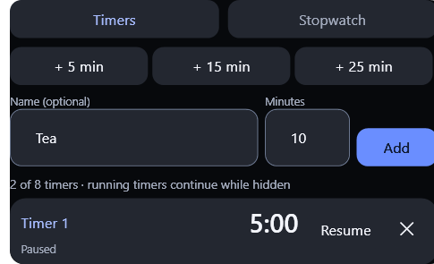

# Crest


[](https://github.com/tanmay-tiwari-20/Crest/actions/workflows/ci.yml)
[](LICENSE)

Crest is a native Windows 11 utility that opens a small island at the top-center of your desktop. A fresh hover reveals music, a focus timer, system controls, shortcuts, and a temporary file shelf. It stays hidden while an application is active by default; an optional setting lets you open it over other apps.

**Crest is a release candidate.** The current source includes core reliability fixes and F09 timers/stopwatch. Native P1 acceptance remains open; the [test report](docs/TEST_REPORT.md) distinguishes this working candidate from the published 0.1.0 build.

## Download and install

Download a packaged application from [GitHub Releases](https://github.com/tanmay-tiwari-20/Crest/releases). Open the release's **Assets** list and choose one of these:

| Package | Use it when | Installation |
|---|---|---|
| `Crest-Setup-0.1.0-x64.exe` | You want Start-menu entries and normal Windows uninstall support. | Run the installer for your Windows user account. A desktop shortcut is optional. |
| `Crest-Portable-0.1.0-x64.zip` | You want to run Crest from an extracted folder. | Extract the ZIP, keep every file together, and run `Crest.exe`. |

Both packages target **Windows 11 x64** and include the .NET runtime. You do not need an SDK, a separate runtime installation, administrator access, or a Crest account. The source-code archives on a GitHub release are for building the application; download an application package to run it.

The installer is currently unsigned. Startup with Windows is off by default and can be enabled in Settings. Portable use still stores preferences in your Windows user profile.

## First use

Crest starts quietly in the system tray. Open **Crest Settings** from Start, double-click the tray icon, or right-click it and choose **Settings**.

1. Close Settings, press **Win+D**, and minimize or close any remaining visible apps on the selected display.
2. Move the pointer away from the top edge.
3. Enter the top-center edge and pause briefly. The default trigger is 240 × 3 device-independent pixels, with a 120 ms hover delay.
4. Click the chevron to expand the focus, music, and battery cards. Use the icon dock below them to open a detail panel.

A stationary pointer does not reveal Crest after Win+D, unlock, resume, or tray Resume. Move away and enter the trigger again. In desktop-only mode, opening an app dismisses Crest. Media and timer activity never reveal it automatically.

The default **strict desktop mode** requires the actual wallpaper desktop to be foreground and ordinary visible apps on the selected display to be minimized. File Explorer, Start, Search, Task View, and foreground apps on another monitor also suppress Crest. The optional desktop-active mode allows visible app windows when the actual desktop is foreground.

To open Crest while using another app, enable **Settings → Behavior → Allow Crest over other apps**. Then enter the top-center trigger on your selected display, or use **Ctrl+Alt+Space** if you also enable the accessibility reveal shortcut. This option is off by default. Settings, tray Pause, lock, suspend, and secure desktop still suppress Crest.

## Features

| Feature | Included behavior |
|---|---|
| Music | Windows media-session metadata and artwork, supported playback and seek controls, and a preferred-player selector when several sessions are available. |
| System controls | Default output volume and mute, Windows-reported battery state, and supported built-in display brightness. |
| Timers and stopwatch (F09) | Eight independent named timers with presets/custom minutes and retained completion; stopwatch with pause/resume and up to 100 saved laps. State survives restarts. |
| Launch shortcuts | Explicit app, file, folder, HTTP/HTTPS website, and Windows shortcut entries. The side rail shows the first two; the detail panel shows the full list. |
| File shelf | Up to 20 session-only references from the wallpaper desktop, with open, drag-out, removal, and missing-source states. Original files are not copied, moved, or deleted by Crest. |
| Personalization | System/light/dark theme, motion preferences, size, trigger, display, module, startup, optional access over other apps, and keyboard reveal. |
| Tray controls | Settings, Pause / Resume, and Quit, with a single-instance application and graceful installer upgrades. |

The [user guide](docs/USER_GUIDE.md) explains each module, keyboard access, upgrades, and removal.




These are static WPF renders using isolated test data, rather than native desktop captures.

## Privacy and local data

Crest has no analytics, required account, clipboard collection, notification access, or online account integrations. Preferences, explicit shortcuts, and timer state live in `%LOCALAPPDATA%\Crest`; the file shelf exists only in memory and clears when Crest quits. Website shortcuts open through Windows when you select them.

**Settings → About → Reset Crest data** asks before clearing Crest's data and disabling startup. Your original files are untouched. Installed uninstall offers a choice to retain or delete local settings.

## Compatibility and release status

This candidate is distributed for Windows 11 x64. ARM64 and Windows 10 packages are not available. Media actions depend on the player exposing a compatible Windows session; brightness and battery details depend on hardware support and the values Windows supplies.

The current candidate passes 46 domain outcomes, eight WPF productivity UI outcomes, and eight release-provenance checks. Full real desktop dragging, shell and app transitions, active/multiple media sessions, keyboard and screen-reader operation, high contrast, physical frame pacing, and clean-account installation still require acceptance. The cold-start and high-refresh budgets have not been established. See the [test report](docs/TEST_REPORT.md) for the evidence and open gates.

The concurrent activity overview is included. Multiple timers and stopwatch are the first F09 expansion in the current source; focus sessions and reminders remain deferred with clipboard history, weather, accounts, and AI integrations. Existing published assets do not acquire these source changes automatically.

## Troubleshooting

**Crest does not appear:** Check the tray icon and Pause state, close Settings, show the desktop, and enter the trigger afresh. Verify the display selected in Behavior. A visible helper window can block strict mode even when the desktop looks empty. In a confirmed case, closing a WhatsApp WebView window restored hover. Close or minimize the relevant app normally and try again.

**Music is empty or controls are disabled:** Start playback in a player that exposes a Windows media session. Crest only enables actions that the player reports as supported.

**Brightness or battery information is unavailable:** These controls use Windows capabilities. An unsupported external display or a missing OS estimate is shown as unavailable.

See the [full troubleshooting guide](docs/USER_GUIDE.md#troubleshooting). Report reproducible problems through [GitHub Issues](https://github.com/tanmay-tiwari-20/Crest/issues), including your Windows version, display/scaling setup, app version, and steps to reproduce.

## Build from source

Maintainers need Windows, Git, and **.NET SDK 10.0.404**, pinned by [global.json](global.json). End users only need a release package.

```powershell
git clone https://github.com/tanmay-tiwari-20/Crest.git
cd Crest
powershell -NoProfile -ExecutionPolicy Bypass -File scripts/release.ps1 -Tag v0.1.0
```

The release script restores locked dependencies, builds, runs outcome tests, publishes a self-contained x64 app, and uses the verified Inno Setup compiler to create an installer and portable ZIP. It uses `.tools/dotnet` when available, otherwise the pinned system SDK. Upload-ready files and checksums go under `artifacts/release/`. Use `scripts/build.ps1` for a build without packaging.

For a development run, quit any other Crest instance first:

```powershell
dotnet run --project src/Crest/Crest.csproj -- --settings
```

Crest uses C#/.NET 10, WPF, Windows media APIs, Core Audio, and WMI. Read the [build instructions](docs/BUILD.md) for packaging details. Contributions should describe the user-visible change and include relevant validation; changes to reveal or suppression behavior must preserve the default desktop eligibility rules and the explicit access-mode setting.

## Documentation

- [User guide](docs/USER_GUIDE.md)
- [PRD analysis and implementation scope](docs/PRD_ANALYSIS.md)
- [Reference design observations](docs/REFERENCE_DESIGN.md)
- [Compatibility and test report](docs/TEST_REPORT.md)
- [Release notes](docs/RELEASE_NOTES.md)
- [Build and packaging instructions](docs/BUILD.md)
- [Release publishing steps](docs/RELEASING.md)
- [Changelog](CHANGELOG.md)
- [Contributing](CONTRIBUTING.md)
- [Security reporting](SECURITY.md)

## License

Original project code, documentation, icon, and current focus artwork use the [MIT license](LICENSE). Dependencies retain their own licenses; see [third-party notices](THIRD_PARTY_NOTICES.md). Editable character artwork is in `assets/focus-orb.svg`; the earlier reference crop was replaced for public distribution.
