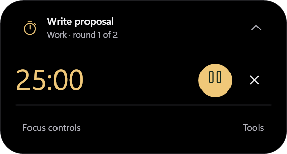
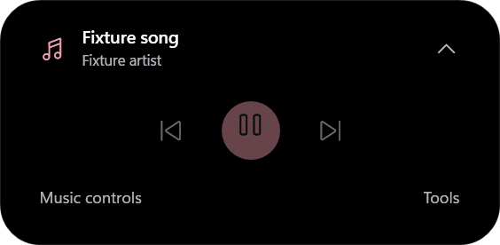
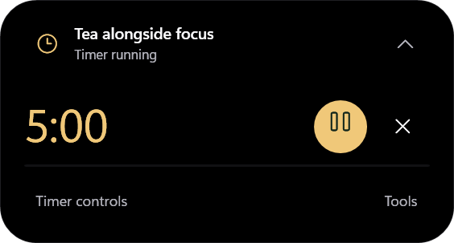
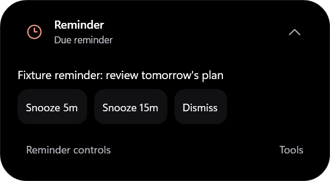
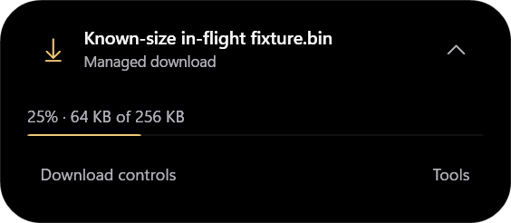
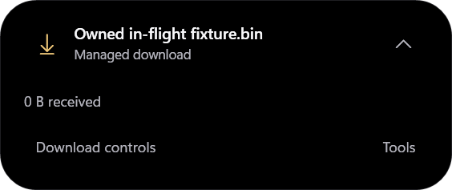
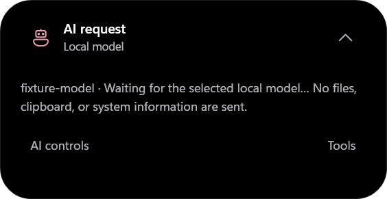

# CREST 0.4.0 contextual island

This report records the 24 November contextual-island prototype that preceded the 0.4.0 release build. It implements the correction described in the [Dynamic Island reference study](DYNAMIC_ISLAND_REFERENCE_STUDY.md). See [release notes](RELEASE_NOTES.md) for the finished Settings and integrations changes.

## What changed

The previous cosmetic overhaul retained a wide dashboard, detached navigation dock and separate detail surface. Compact focus could also expand into an unrelated timer preset. CREST now has one black primary envelope enclosing activity, tools and detailed controls. The same compact header moves into the expanded activity, and both read one immutable selected activity snapshot.

Idle uses a quiet 186 × 48 DIP crest/Idle pill. A real activity uses 272 × 48 DIP. Clicking it expands that activity at 376 DIP wide; the height follows its content. Tools and full module forms use a 440-DIP envelope capped at 528 DIP high, with internal scrolling. Dynamic form changes update its height through a queued layout notification. The existing desktop fit/scaling strategy remains in place.

Up to two secondary bubbles represent other real activity kinds. Selecting one enlarges that same activity. Timers, work/break focus, due reminders, acknowledged Windows battery warnings, media sessions, opted-in running managed downloads and actual busy local AI requests provide context. Download percentages use reported received/total bytes; unknown-size transfers show received bytes. AI has no artificial percentage or prompt preview. Finished operations disappear. Inactive features remain in the tools catalogue, preserving every existing workflow.

Full activity actions open their corresponding existing controls, including Focus/Reminders and Downloads/AI sections. Compact and expanded actions share a guarded command gate. Focus commands validate their expected session ID inside the service lock; a stale control cannot affect a replacement session. Media seeks cancel when the track/player, capability or duration changes.

## Appearance, motion and access

The normal island material remains opaque black across all six appearance choices, with white primary text, gray supporting text and distinct activity accents. Settings retains its themed surfaces. Windows high contrast uses system brushes. The original open-summit CREST mark, scalable WPF/SVG variants and multi-resolution Windows icon from the earlier overhaul remain the application identity; no Apple assets or camera-shaped gap are used.

Native analytic springs preserve position and velocity during rapid reversal. One rounded geometry drives the painted envelope, clip and native hit region. Outgoing content remains masked during contraction and stops receiving input immediately. The outer window and full layout are not resized each animation frame. Reduced motion applies geometry immediately with a minimal show fade; suppression and closing release clocks and prevent stale completions from restoring the island.

Expanded activities have one visible primary action in the body. The retained compact header supplies identity and collapse; its compact primary action appears again when the island contracts, avoiding competing duplicate controls.

Keyboard focus, automation names, visible focus feedback, existing surface gestures, accessibility reveal, desktop eligibility and fresh-entry behavior remain supported. Activity changes do not auto-reveal the overlay. Optional services retain their opt-in and notification policy.

## Scope and files

All existing Settings pages and detailed feature panels use the shared design system from the [earlier overhaul](PREMIUM_UI_REPORT.md). The contextual correction changes `IslandWindow.cs` and its context/integrations partials, `ActivityDeck.cs`, `IntegrationsPanel.cs`, `LocalHub.Productivity.cs`, appearance resources and the project version. It adds `Core/IslandActivity.cs`, `UI/IslandActivityCatalog.cs`, `UI/IslandEnvelope.cs`, domain activity tests and envelope presentation fixtures. The prior spring, branding and shared-component files remain in use. No application package dependencies were added or removed; no framework migration occurred.

## Verification and delivery

| Check | Final result |
| --- | --- |
| Domain suite | 156 outcomes passed |
| Full WPF regression suite | 177 outcomes passed, preserving all 147 original feature outcomes plus 30 contextual/presentation outcomes |
| Geometry probe | 10 outcomes passed |
| Builds and self-contained Release publication | Succeeded with warnings treated as errors; no warnings or errors |
| Exact binary | Published DLL, WPF runner, geometry runner and their evidence records match |
| Presentation renders | All 78 manifest images exist; six Settings themes, 960/700 widths, full module panels and natural-proportion activity fixtures inspected |
| Native installed application | Opened from the installed path; Settings Overview and Appearance display 0.4.0 and the new black Idle preview |
| Existing user data and shortcuts | Settings hash unchanged after restart; both Start-menu shortcuts still target the updated installed executable |
| Windows installation metadata | Existing uninstaller retained; uninstall entry now displays 0.4.0 |

The tested and installed `Crest.dll` SHA-256 is `CD83887DB6387078AF929863894C9326BF3C7FE6CCA88DC52A132D227C6B197B`. The [machine-readable verification](contextual-verification-0.4.0.json) records commands, binaries, exact counts and exclusions. UI/geometry checks run from isolated probe folders overlaid with the actual self-contained Release files, rather than substituting a different Debug application.

The prototype was tested in an existing per-user installation after backing up the prior installation and user data. Runtime file hashes matched the local publish. These observations apply to the prototype identified above.

Eleven native clipboard-writing outcomes were explicitly omitted and are not counted as passed. Physical mixed-DPI hovering/OLE dragging, provider/device capabilities, screen-reader operation and sustained frame delivery remain hardware acceptance limits. No measured 60/120 FPS guarantee is claimed. A later native Settings smoke sample recorded 141.1 MiB working set and 31.25 CPU ms over 5.01 seconds after UI inspection settled. This brief observation is not a hidden-idle, leak, battery or performance benchmark; the earlier short post-inspection sample is retained in the raw record. Its source is `artifacts/contextual-native-smoke.json`.

## Visual evidence

These are static WPF fixture renders. The sample focus, timer and media titles represent isolated test state, not activity added to the user's installed profile. Crops retain their original proportions. The [earlier overhaul report](PREMIUM_UI_REPORT.md) preserves the former dashboard images and branding history for comparison.

The same layout also covers the independent timer, due reminder and genuine pending HTTP/local-model operations. Unknown-size downloads show received bytes without a fabricated percentage; known-size transfers show the real percentage and byte totals. Expanded headers identify the context, while the body contains the full reminder or operation status.

