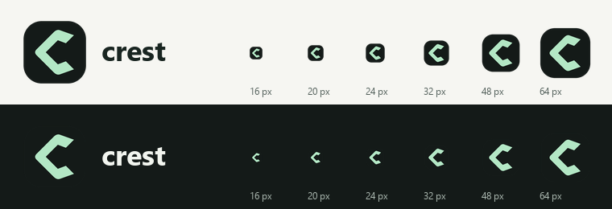
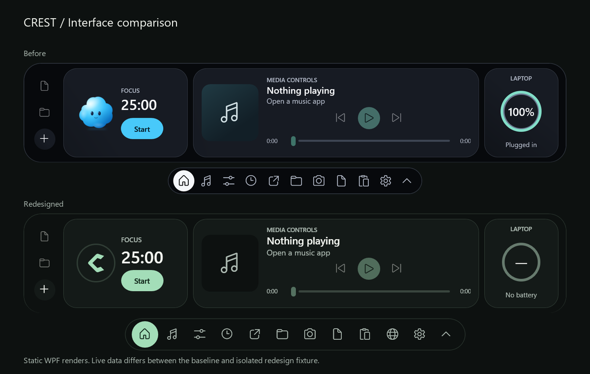
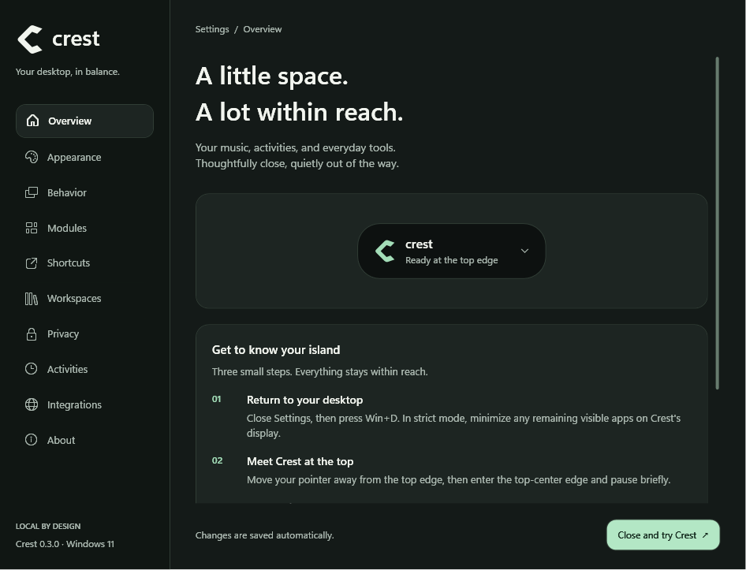
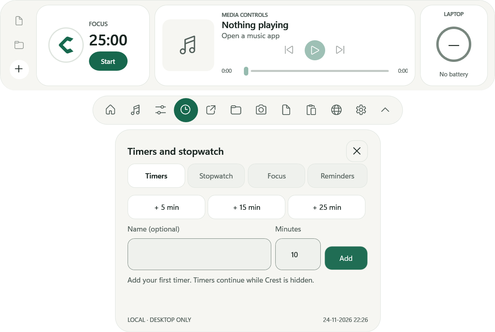
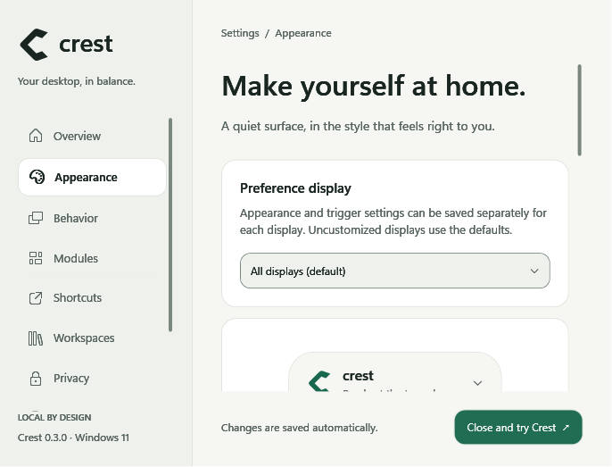

# CREST premium UI overhaul

This report records the earlier cosmetic 0.3.0 overhaul. The [0.4.0 contextual-island report](CONTEXTUAL_ISLAND_REPORT.md) supersedes its dashboard architecture, activity presentation, final test counts and installed-build status.

Completed locally on 24 November 2026. The native C#/.NET 10 WPF architecture and existing feature services remain in place. A self-contained Windows x64 build is in `artifacts/premium-app/`. The running review instance uses `artifacts/premium-native-profile/` for isolated preferences.

## Audit and reference analysis

The original interface combined very small supporting labels, uneven spacing, gradient card fills, inconsistent button boundaries, a raster application identity and a separate cartoon focus illustration. Settings was a dense preference form. Shell, dock and detail animations used separate fixed-duration cubic curves, which discarded velocity when an interaction reversed.

The [preimplementation specification](PREMIUM_DESIGN_SPEC.md) documents the complete architecture, feature and screen audit. The reference study used Apple's [Design dynamic Live Activities](https://developer.apple.com/videos/play/wwdc2023/10194/), [Animate with springs](https://developer.apple.com/videos/play/wwdc2023/10158/), [Live Activities guidelines](https://developer.apple.com/design/human-interface-guidelines/live-activities) and [Motion guidelines](https://developer.apple.com/design/human-interface-guidelines/motion).

The applicable principles are a stable spatial anchor, compact essential information, concentric rounded surfaces, inset expanded controls, restrained layering, and continuity of position and velocity. On Windows, existing hover, click, keyboard, wheel and configured surface gestures remain the interaction model. CREST does not reserve a fake sensor cutout or introduce a new long-press gesture that would interfere with desktop controls and file dragging. No Apple artwork, fonts, private constants or proprietary implementation is used.

## Design language and branding

The new system uses ink surfaces, warm chalk light surfaces, mineral green accents, fine dividers and clear raised/inset elevations. Typography uses Segoe UI Variable with a Segoe UI fallback, stronger heading hierarchy, tabular timer digits and readable supporting text. Shared spacing, cards, focus rings, hover fills and press feedback replace inconsistent per-screen decoration.

CREST's original open-summit symbol suggests an open C in a strong, rounded geometric silhouette. A native frozen WPF geometry supplies navigation and appearance previews; the same source geometry supplies SVG mark/wordmarks, a 512px application image and a nine-size 16–256px Windows icon. Light/dark monochrome variants use the respective text colors. The tray, taskbar, navigation and README use the new identity. There was no separate startup loading screen or browser favicon to replace. The focus card now uses a real timer-progress dial around the mark; existing source illustration assets remain available.

## Screens and components

All ten Settings pages were updated: Overview, Appearance, Behavior, Modules, Shortcuts, Workspaces, Privacy, Activities, Integrations and About. The sidebar retains stable button instances and keyboard order, with a selected-state indicator and a fixed save/try footer. Page content scrolls independently. Appearance previews use actual theme tokens.

The compact island, expanded activity deck, module dock and detail container were redesigned. Detail coverage includes Music, Controls, Timer, Launch, Shelf, Capture, Workspaces, Clipboard and Integrations. Existing focus, timer, media, battery and reminder priority determines compact status and actions; idle/unsupported states remain truthful. The existing desktop eligibility, suppression, opt-in integrations and fresh-entry rules are retained.

Shared panels cover timers/stopwatch, focus/reminders, clipboard, audio outputs/system/connectivity, weather/calendar, downloads/local AI and notifications/accessories/Phone Link. Buttons, text fields, dropdowns, checkboxes, lists, progress bars, tooltips and scrolling use one theme system. Download bars display only actual reported progress. The reset confirmation is now owner-modal and themed, with Cancel focused/default, Escape dismissal and the original reset action behind confirmation.

## Motion implementation

`SpringDynamics` samples the closed-form damped oscillator. `SpringMotion` uses native WPF animation clocks and reads their actual compositor time when inheriting velocity. The shell uses a 0.32-second response and 0.86 damping ratio; content/translation springs use calmer responses and critical or near-critical damping. MotionSpeed scales response consistently. Eleven decay time constants bound residual displacement before clocks are removed.

Only the clip rectangle, opacity and transforms move during the transition; the full visual tree and Window dimensions are not resized every frame. The compact content exits before the deck becomes prominent. Outgoing content remains present through contraction, while hit testing follows the intended state. Per-track identity and controller transition versions reject obsolete completions. Suppression and closing clear every spring clock.

Reduced motion applies geometry and position immediately with a minimal 60ms visibility fade. The fade must complete before acknowledging a visible battery warning. Rapid interactions exposed and fixed a WPF first-frame base-value jump; new clocks now attach at the displayed value and commit the destination only when finished.

## Themes and accessibility

System, Dark, Light, Ocean, Forest and Rose remain selectable, including per-display appearance preferences. Theme changes coordinate mutable brush colors over a short transition; reduced motion and Windows high contrast bypass it. Foreground, inset, boundary, accent and status roles use dynamic resources throughout the shared components. High contrast maps to Windows system brushes.

Representative contrast checks: light muted text 5.89:1, dark muted text 7.62:1; accent action text 6.22:1 light and 11.26:1 dark; light input boundary 3.31:1 against the inset surface. Keyboard focus and automation names are retained. Navigation selection is exposed through ItemStatus. Default controls and dock targets are 40 DIP; compact media controls retain their denser native desktop layout.

## Verification and performance

| Check | Result |
|---|---|
| Original baseline | 139 domain outcomes and 147 UI outcomes passed |
| Final domain suite | 144 outcomes passed, including 5 spring physics outcomes |
| Final WPF suite | 156 outcomes passed: 147 existing plus 9 new presentation outcomes |
| Platform geometry probe | 10 outcomes passed |
| Compilation | Warning-as-error Debug app/probes and self-contained Release x64 publication succeeded |
| Visual coverage | 70 isolated WPF screen renders; all 10 Settings pages at 960/700 widths in light/dark, all island modules, compact states, and extra System/Ocean/Forest/Rose samples |
| Native inspection | Published application opened; native navigation, appearance dropdown, light theme, Activities and Stopwatch inspected successfully |
| Native resource smoke sample | 162.8 MiB working set, 99.3 MiB private memory; 0 recorded CPU ms during a 2.059-second idle Settings sample; no UI-fault diagnostics |

Spring tests establish sample-rate independence at 30/60/120/144 Hz, boundary velocity continuity, subpixel convergence and 100 rapid reversals. WPF tests establish first-frame continuity, 30 live expand/collapse reversals, settled clock removal, suppression without resurrection, reversing an animated close, live reduced-motion changes and bounded controls on every Settings page. Existing tests retain feature, native hit-region, battery-warning, media/control write, integration and keyboard-navigation checks. Geometry fixtures now derive points from the actual dock/detail bounds.

Evidence: `artifacts/premium-domain-outcomes.json`, `artifacts/premium-after-ui/ui-outcomes.json`, `artifacts/premium-after-ui/premium/render-manifest.json` and `artifacts/premium-native-smoke.json`. The UI outcomes target the final Debug assembly; the Release publication was separately built and inspected natively.

Eleven native clipboard-writing outcomes were explicitly omitted with the project's supported flag and are not counted as passed. Physical mixed-DPI desktop hovering/OLE dragging, every device/provider capability, screen-reader operation and sustained frame delivery remain separate hardware acceptance. The resource sample is a brief smoke observation, not a memory-leak, battery or hidden-idle benchmark. No measured 60/120 FPS guarantee is claimed. The island preserves the existing display-fit scaling strategy; extremely narrow displays may reduce text size. These are the remaining verification limits; there are no knowingly unfinished UI components.

## Visual evidence

These are static WPF renders, not desktop captures. Baseline live hardware data differs from the isolated empty service state used for redesign fixtures.

## Files and dependencies

Modified: `README.md`; `assets/crest.ico`, `assets/crest.png`; `src/Crest/App.xaml`; `src/Crest/UI/ActivityDeck.cs`, `Design.cs`, `IslandWindow.cs`, `SettingsWindow.cs`, `SettingsWindow.Local.cs`, `ClipboardHistoryPanel.cs`, `DownloadAiPanel.cs`, `IntegrationsPanel.cs`, `P2SystemPanel.cs`, `ProductivityExtrasPanel.cs`, `TimerToolsPanel.cs`, `WeatherCalendarPanel.cs`, `WindowsIntegrationsPanel.cs`; `tests/Crest.Tests/Crest.Tests.csproj`, `tests/Crest.Tests/Program.cs`, `tests/Crest.UIProbe/Program.cs`.

Created: `src/Crest/Core/SpringDynamics.cs`; `src/Crest/UI/SpringMotion.cs`, `CrestBrand.cs`, `CrestDialog.cs`, `PanelLayout.cs`; `tests/Crest.Tests/SpringDynamicsTests.cs`, `tests/Crest.UIProbe/PremiumPresentationChecks.cs`; `scripts/generate-brand.py`; `assets/crest.svg`, `crest-mark.svg`, `crest-light.svg`, `crest-dark.svg`; `docs/PREMIUM_DESIGN_SPEC.md`, this report; `docs/images/premium-brand.png`, `premium-before-island.png`, `premium-dark-island.png`, `premium-dark-settings.png`, `premium-light-settings.png`, `premium-light-timer.png`, `premium-comparison.png`. Build, preview profiles, detailed renders and machine-readable QA records are under ignored `artifacts/`.

Removed files: none. Application package dependencies added/removed: none. The brand regeneration script uses the existing build-time Python/Pillow environment; Pillow is not shipped or required by CREST. No framework migration, service replacement, deployment or public release was performed.
